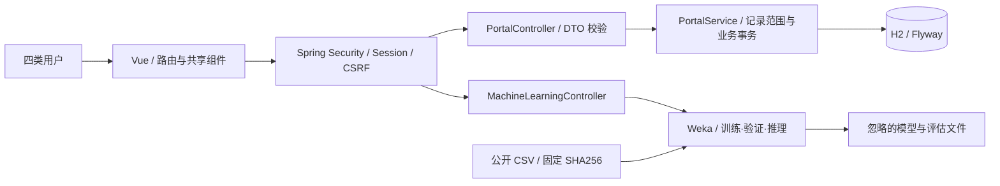

# 系统架构

项目采用单仓库、模块化单体后端与独立 Vue 前端。浏览器通过同源 `/api` 访问服务，Vite 开发代理连接本机 Spring Boot；H2 文件库由 Flyway 迁移，Hibernate 仅验证结构。

| 实现位置 | 职责 |
| --- | --- |
| auth、config | Cookie 会话登录、退出、CSRF、认证入口 |
| common | 可读错误响应和输入校验失败处理 |
| demo | 固定演示账号、CSV 解析、首次数据初始化 |
| portal | 档案、测评、打卡、规则分级、预警、干预与站内通知 |
| ml | 两种数据模式、Weka 训练/评估/推理、模型与指标产物 |
| system | 匿名健康与 Demo 元数据 |
| frontend/src/views | 工作台、档案、模型实验、个案、学生与联系人页面 |
| frontend/src/components | 图表、状态反馈、学生抽屉、个案抽屉、图标与分级徽标 |

服务端对角色和记录归属同时授权：中心全校、辅导员本学院、学生本人、联系人自己的最小通知。前端导航仅改善体验，不作为安全边界。所有写请求携带 CSRF 令牌；登录后重新获取令牌，退出销毁会话。

业务链路：自评/打卡 → 事务内记录 → 规则评估 → 非常规关注触发预警 → 站内提醒 → 受理 → 干预记录 → 人工复评 → 关闭。测评有请求幂等键，打卡有学生/日期唯一约束，已有未关闭预警仅在等级升级时重复提醒。

机器学习是独立实验通道。用原始公开数据建立监督模型，预测数据集标签；不以合成平台历史训练，也不自动用模型概率创建四级预警。这样保留清晰的标签语义和可解释的人工关怀流程。

已保留的学生 JPA 实体/Repository 支持基础持久化测试；实际 Demo 查询由 JdbcTemplate 执行。其他课程预留包不暴露占位接口。模型仅使用本次进程训练对象，不从任意上传文件反序列化。
