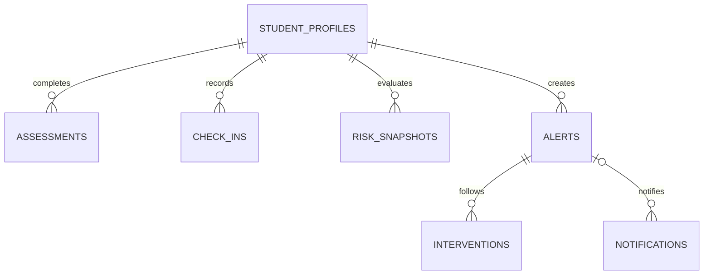

# 数据库与持久化

默认 H2 文件库位于 `backend/runtime/campus-mental-health.mv.db`。从 `backend` 启动后端，保持相对路径一致；测试使用独立内存库。Flyway 执行 V1、V2，JPA `ddl-auto=validate` 禁止自动重建。

| 表 | 内容与关键约束 |
| --- | --- |
| student_profiles | UUID、唯一学号、姓名、学院/专业/年级/性别/年龄、联系人称呼、最新关注等级/分数/活动时间、来源 |
| assessments | 学生 FK、9 项答案、0–27 总分、关注等级、来源、时间；request_id 全局唯一 |
| check_ins | 学生 FK、心情 1–5、睡眠 0–24、压力 1–5、备注、来源、日期；学生/日期唯一 |
| risk_snapshots | 学生 FK、分数、等级、关注理由、时间；保留变化历史 |
| alerts | 学生 FK、关注等级、状态、理由、受理人、创建/更新时间、关闭说明 |
| interventions | 预警 FK、行动类型、记录、下次随访日期、作者、时间 |
| notifications | 预警 FK（可空）、收件账号、标题、最小提醒、已读标志、时间 |
| app_meta | 数据初始化日期和来源摘要；防止重启重复播种 |

测评、打卡、评估与通知在业务事务中执行。受理/复评/关闭按合法前置状态更新；并发变更造成的状态不一致返回 409。关闭保留全部历史，不自动清除学生关注等级。CSV 导入逐行提交，成功条目保留，返回失败行而不伪装整批成功。

数据库首次启动播种一次：小问卷存在则使用 101 条问卷的部分匿名属性映射，姓名、学院关联、PHQ 历史、打卡、预警与随访都为虚构；缺少问卷则生成 36 份完全合成档案。后续操作来源为学生自评、学生打卡或演示录入。

十万条生活方式数据不导入 H2 档案库，只用于 Weka 实验。所有数据库、原始 CSV、模型与缓存被 Git 忽略。

备份时先停止后端，再复制数据库文件。重置 Demo 时先备份、停止服务，然后只移走当前项目的数据库文件；下一次启动重新迁移与播种。不要在运行时删除数据库，不清理其他项目的工具或 SSH 文件。已共享使用的迁移不得重写，结构变更新增迁移。
