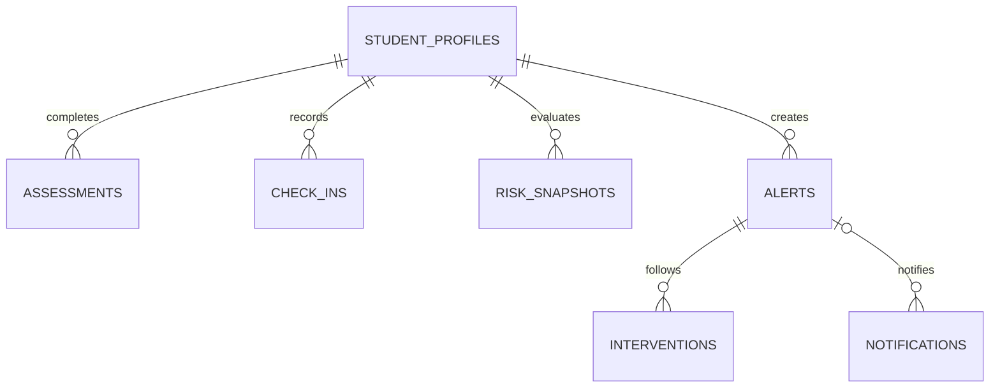

# 数据库与持久化

默认 H2 文件库位于 `backend/runtime/campus-mental-health.mv.db`。从 `backend` 启动后端，保持相对路径一致；测试使用独立内存库。Flyway 执行 V1、V2、V3，JPA `ddl-auto=validate` 禁止自动重建。

| 表 | 内容与关键约束 |
| --- | --- |
| student_profiles | UUID、唯一学号、姓名、学院/专业/年级/性别/年龄、联系人称呼、最新关注等级/分数/活动时间、来源 |
| assessments | 学生 FK、9 项答案、0–27 总分、测评级别、提交时综合规则级别、来源、时间、稳定排序序号；request_id 全局唯一 |
| check_ins | 学生 FK、心情 1–5、睡眠 0–24（最多一位小数）、压力 1–5、备注、来源、日期；学生/日期唯一 |
| risk_snapshots | 学生 FK、分数、综合规则等级、关注理由、时间；保留评估历史 |
| alerts | 学生 FK、关注等级、状态、理由、首次受理人、创建/更新时间、关闭说明、已处理优先测评 ID（FK） |
| interventions | 预警 FK、行动类型、记录、下次随访日期、随访状态、作者、时间 |
| notifications | 预警 FK（可空）、收件账号、标题、最小提醒、已读标志、时间 |
| app_meta | 数据初始化日期和来源摘要；防止重启重复播种 |

测评、打卡、评估与通知在业务事务中执行，同学生的信号和个案写操作通过学生行锁串行处理，保证正常接口写入中一个学生仅有一个活动个案。测评时间相同时使用序号确定最新记录，提交时的综合规则级别持久化在测评记录中，幂等重试保持稳定。相同测评请求和同内容的当天打卡重试直接返回已有记录，不重新评估或重复生成风险快照。

受理/干预/复评/关闭按合法前置状态更新；并发变更造成的状态不一致返回 409。待复评期间等级升级或新增第 9 项非零自评会退回受理状态，须重新干预并复评。`assigned_to` 保留首次受理人，干预作者单独记录。关闭须提供人工复评说明，保留全部历史，不自动清除学生关注等级。

V3 新增测评排序与综合规则级别、优先测评 FK、随访状态及其枚举约束，并整理旧随访数据。V2 未保存测评提交时的完整综合规则输入，因此历史测评的 `rule_risk_level` 以原 `risk_level` 确定性回填；V3 起的新测评保存真实提交时综合结果。`follow_up_status` 仅允许 `NONE / PLANNED / SUPERSEDED / CANCELLED`；每次新干预将旧当前计划标为 `SUPERSEDED`，即使新干预没有随访日期也撤销旧计划；关闭将当前计划标为 `CANCELLED`。当前计划用于工作台统计，被替代或取消的计划保留为历史。通知查询与标已读同时检查收件账号及辅导员对学生当前学院的权限。

V3 为避免自动删除干预、通知等审计历史，不会猜测合并数据库中既有的重复活动个案。正常 V2 服务写入已经按学生档案更新串行；若数据库曾被手工改写或异常导入，升级前应先查询 `alerts` 中同一学生多条 `status <> 'CLOSED'` 的记录并由工作人员确认保留项、关闭其余个案，再执行升级。

CSV 导入逐行提交，成功条目保留，返回失败行而不伪装整批成功。

数据库首次启动播种一次：小问卷存在则使用 101 条问卷的部分匿名属性映射，姓名、学院关联、PHQ 历史、打卡、预警与随访都为虚构；缺少问卷则生成 36 份完全合成档案。后续操作来源为学生自评、学生打卡或演示录入。

十万条生活方式数据不导入 H2 档案库，只用于 Weka 实验。所有数据库、原始 CSV、模型与缓存被 Git 忽略。

备份时先停止后端，再复制数据库文件。重置 Demo 时先备份、停止服务，然后只移走当前项目的数据库文件；下一次启动重新迁移与播种。不要在运行时删除数据库，不清理其他项目的工具或 SSH 文件。已共享使用的迁移不得重写，结构变更新增迁移。
